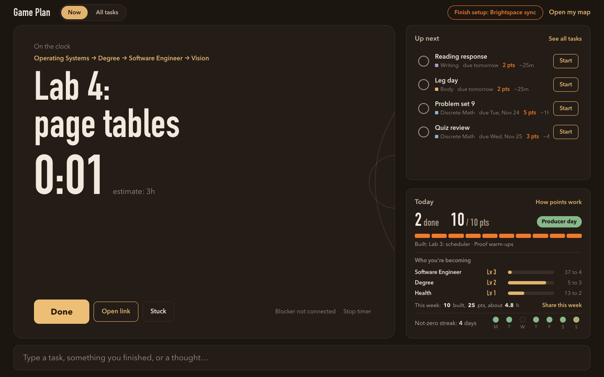
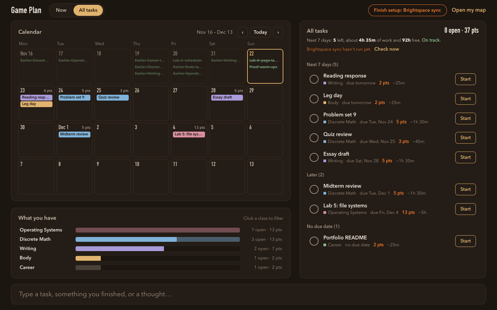

# Game Plan

One screen, one next thing. A local planner that runs on your Mac, reads and writes an Obsidian
vault, and keeps every finished task linked up to the goal it serves.


| On the clock | Done |
|---|---|
|  |  |



*Screenshots use a made-up demo vault (`desktop/tests/demo.py`).*

## What it does

- **Do this now.** The single most urgent task, ranked by deadline, size and your free time, with one line on why it's first. **Start** is one click and shows the estimate. **Open in Brightspace** goes straight to the assignment. **Done** plays one short burst and shows where the points go: `+5 pts → class → goal → bigger goal`, with an **Undo** if it was a mis-click. **Stuck?** gives a question, then a hint, then a worked example of a *similar* problem.
- **Up next.** The next five tasks in order, each with Start and a done circle.
- **Sizes that fit the task.** Claude estimates each open task in minutes, calibrated on how long your finished tasks actually took; points follow from the minutes. Wrong size? Click the points to set it yourself (that sticks).
- **Live.** The page updates within 2 seconds of any change (Obsidian, the Brightspace sync, another window), and the map and notes redraw just as fast.
- **Today and who you're becoming.** How many tasks you finished today and what they were, points against 10 (a *producer day*), and a level for each goal: every finished point is proof for the person you're becoming. **How points work** explains it.
- **All tasks.** The next 7 days' work against your free time ("On track" / "Tight"), a 4-week calendar with each day's load, a "what you have" graph of open work by class (overdue in red), and every task in one list. A task's name opens it in Brightspace (in Chrome). Click a day or a class to filter.
- **Brightspace sync.** The Chrome extension checks your submissions with the login already in Chrome: submitted there means done here, dated by the submission. Anything you mark done that Brightspace shows as not submitted gets flagged. It only reads; it never submits anything.
- **One box for everything.** Type a task, something you finished, or a thought. Claude files it, links it to the right class and goal, and sizes it. Thoughts open **Spitball**: sharp questions, never a finished answer.
- **The map.** `07 Map/Map.canvas` in Obsidian, redrawn whenever something changes: each goal is a colored group with its level, and inside it the areas, classes and projects with their open tasks (overdue red, due within 2 days orange). Every goal, area and class note opens on a level card, what's open (with Brightspace links) and what you've built lately.
- **Night check-in** after 9pm: two questions, saved to the daily note.
- **Open it from anywhere** with **⌥⌘G** (Option-Command-G), or ⌘Space → "Game Plan". It reuses the open window.
- **Runs on its own.** Starts at login. Writes each day's note at midnight (zero days too). At most 4 macOS notifications a day, only in free time from `System/schedule.md`, never within 90 minutes of a Start, and fewer for tasks you keep ignoring.
- **Blocker.** While the timer runs, distracting sites show a back-to-work screen. From 10:30pm to 7am, streaming and short-video sites need a typed sentence to open.

### How points work

Points are proof. Every finished task is evidence for the person you're becoming.

| Points | Time it really takes |
|---|---|
| 1 | under 15 min |
| 2 | 15–30 min |
| 3 | 30–60 min |
| 5 | 1–2 h |
| 8 | 2–4 h |
| 13 | 4 h or more |

- **Levels and ranks.** A task's points go to its class, then up to its goals. 20 points reaches level 2, then 30 more, 40 more… Each level has a rank (Walk-on, Bench, Rotation, Starter, Captain, All-Star, MVP, Champion, Hall of Famer, Legend) and stands for real hours of work already done. Click a goal to see its ladder and latest proof. Levels never go down, so a neglected goal stays visibly low until you feed it.
- **This week's build list.** One click copies what you finished this week, grouped by class, to send to someone who should see you building.
- **Producer day.** 10 points in a day means the day's work is done. Everything after is a bonus, no guilt.
- **Not-zero streak.** Any day with at least 1 point.

## How it works

The vault is the database. There is no second task list.

```
07 Map/Vision.md                ← Goal - …  ← Area - …  ← class/project hub  ← task notes
00 Inbox/Ideas/                   idea notes (#idea)
06 Daily/YYYY-MM-DD.md            what you finished that day, night check-in
06 Daily/Weekly/                  Sunday reviews
System/schedule.md                when you're busy (classes, work, sleep)
System/experiments.md             the experiment queue and your daily reward
```

Tasks are `type: assignment` notes with `class`, `status`, `due`, `points` (1/2/3/5/8/13), `first_step`,
`my_estimate_min`, `actual_min`, `done_date`, `brightspace_url` (the vault's morning sync reads it from the
Brightspace calendar feed). Each note links to its parent with a `Part of [[…]]` line,
and Game Plan keeps a `📊 12 done · 62 pts · 9h 40m · last: Nov 21` line under every hub, area, goal and
the vision, so finished work visibly adds up in Obsidian's graph. AI calls run `claude -p` from the vault
folder, so the vault's own `CLAUDE.md` gives Claude its context.

## Install (macOS)

Needs: Python 3 (the system one is fine), Google Chrome, [Claude Code](https://claude.com/claude-code)
signed in, and an Obsidian vault with `System/scripts/vaultlib.py` (the vault's helper scripts).

```sh
zsh desktop/install.sh          # login service on http://127.0.0.1:4317 + "Game Plan.app"
```

Then in Chrome: `chrome://extensions` → Developer mode → **Load unpacked** → `desktop/extension`.
A "Connect Brightspace" page opens: press it once and allow access to your Brightspace site.
`zsh desktop/install.sh --uninstall` removes it. Your vault is never touched by uninstalling.

## On a bad day

1. Open Game Plan. Look at one task only.
2. Type the smallest first step you can do in 2 minutes, and a number of minutes.
3. Press Start. Do just that step.
4. Stuck? Press Stuck and answer the question.
5. Press Done. One point is still a not-zero day.

## Files

| Path | What |
|---|---|
| `desktop/server.py` | HTTP server (localhost only), actions, Claude calls, midnight notes, notifications |
| `desktop/vault.py` | Reads and writes the vault: tasks, map, stats, schedule, ranking |
| `desktop/app/` | The page: plain HTML, CSS and JS, no build step |
| `desktop/extension/` | Chrome blocker (focus timer + night lock) |
| `desktop/import_history.py` | One-time import from an older Game Plan export |
| `desktop/tests/` | Unit tests, an end-to-end test, the demo vault |

## Tests

```sh
python3 -m unittest discover -s desktop/tests -p 'test_v3.py'                     # unit + flow tests (Claude stubbed)
uv run --with playwright python desktop/tests/e2e.py --vault COPY --shots OUT     # real clicks, on a COPY of a vault
/System/Library/Frameworks/JavaScriptCore.framework/Versions/Current/Helpers/jsc -m desktop/tests/bs_test.js   # Brightspace parsing
```

## Privacy

Everything stays on your Mac: the server only listens on `127.0.0.1`, it reads and writes only the
vault, and personal files (`import/`, anything personal in the vault) are gitignored. See
[ROADMAP.md](ROADMAP.md) for what's next.
