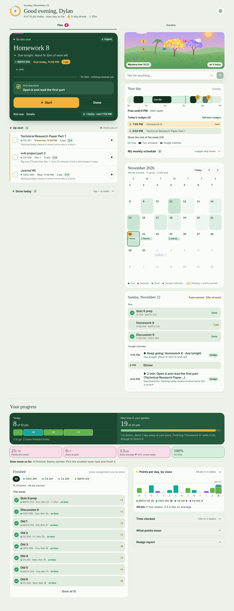
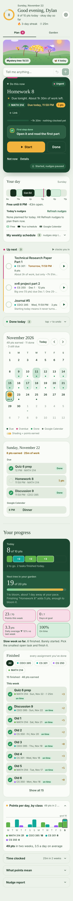
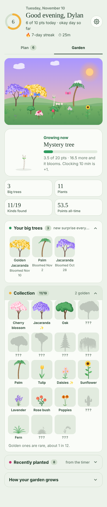

# Game Plan

An AI planner that turns what you type into ranked tasks, tells you the one thing to do now, and pings your phone through Google Calendar until you start it. Finishing work earns points that grow a garden.

## Why I built it

My problem was never keeping a to-do list. It was starting. Game Plan is built around that: one task at a time, a two-minute first step, and reminders timed for when I'm actually free.

## What it does

- **Plain-English input.** Type "CS 350 homework due Friday, gym tonight" and an LLM turns it into sized, dated tasks with a two-minute first step. Every change can be undone.
- **Priority engine.** Ranks tasks by work left versus free time before the deadline, using Google Calendar events and weekly busy blocks. Each task shows *why* it's ranked where it is.
- **Smart phone nudges.** Writes reminders to Google Calendar: up to 3 a day for urgent tasks, 1 for "start today" tasks, capped at 5 a day, spaced at least an hour apart. They stop once you start a task, learn which hours you actually respond to, and back off tasks you keep ignoring.
- **Free-time-aware nudges.** You enter your weekly schedule (or tell the chat "I work Mon–Thu 9 to 5"); nudges only land in the gaps between classes, work and calendar events, right after something ends, and at a different time each day so they don't become background noise.
- **"Your day" timeline.** A bar showing free time, schedule, calendar events and where today's nudges land, with a refresh button and the rest of the week's nudges.
- **Brightspace import.** Pulls class deadlines from the D2L calendar feed and links each task to its submit page. Shows when Google last refreshed the feed and offers a direct file upload when it lags.
- **One-page board.** "Do this now", the ranked lineup, a month calendar and progress all on one screen.
- **Points, not hours.** Tasks are worth 1 to 13 points by size, with a daily goal that separates good days from slow ones. Progress shows today's points stacking up, a 14-day chart split by class, and a daily average compared with last week.
- **Timer.** A count-up timer that grows a plant every 25 minutes. Time is tracked for the record; points are what count.

| Phone | Garden |
|---|---|
|  |  |

## How it's built

- **JavaScript, HTML and CSS** in a single file (`index.html`), with no framework or build step.
- **Claude API** for parsing input and sizing tasks, using structured JSON output.
- **Google Calendar API** through MCP for reading busy time and creating, updating and deleting reminder events.
- **Real-time document database** (Firestore-style) that keeps phone and laptop in sync.
- **Playwright end-to-end tests**, with the database and calendar mocked, run against both sample data and a snapshot of real usage.

### Problems worth mentioning

- **Duplicate reminders.** With the app open on two devices, both planned nudges. A short database lease now lets only one copy plan, and a cleanup step removes reminders no task is tracking. A second planning pass makes zero calendar calls (idempotent).
- **Devices undoing each other.** Saving whole documents let one device overwrite another's changes. Switching to merge-writes of only the changed fields fixed it.
- **A stopped timer coming back.** Late database updates could restore a timer that had already been stopped. The app now ignores updates for sessions it has already ended.

## Running it

Game Plan runs as an artifact inside Claude, which provides its database, Google Calendar access and AI calls. `index.html` is the full app. Opened as a plain web page, it loads but shows "Open Game Plan inside Claude" because those services aren't there.
