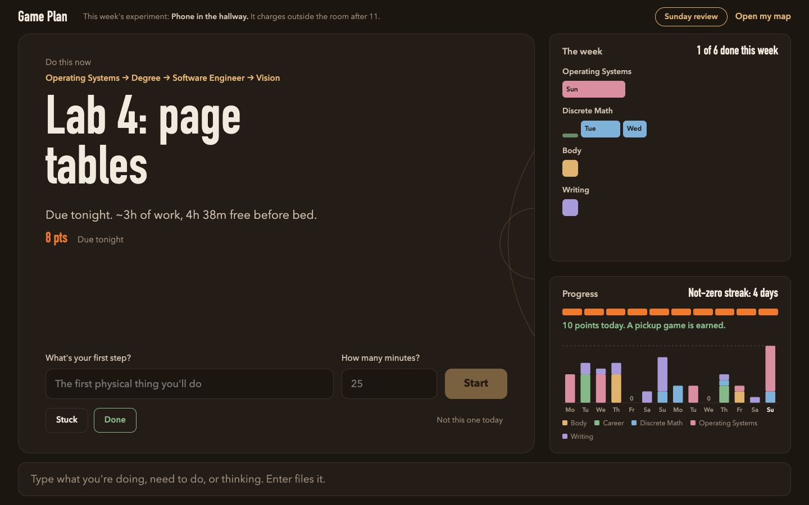
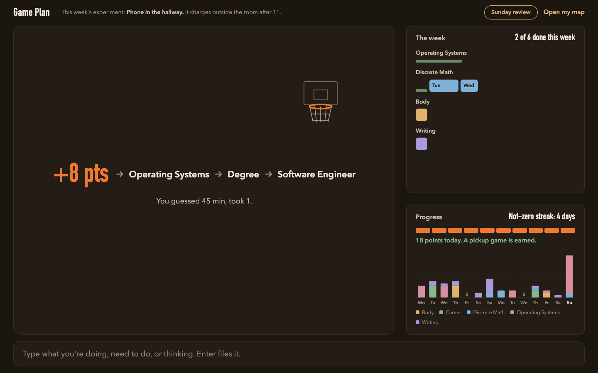

# Game Plan

One screen, one next thing. A local planner that runs on your Mac, reads and writes an Obsidian
vault, and keeps every finished task linked up to the goal it serves.



| On the clock | Done |
|---|---|
|  |  |

*Screenshots use a made-up demo vault (`desktop/tests/demo.py`).*

## What it does

- **Do this now.** The single most urgent task, ranked by deadline, size and your free time, with one line on why it's first. Before **Start** you type your first step and how many minutes you think it takes. **Stuck** gives a question, then a hint, then a worked example of a *similar* problem, one at a time. **Submit** opens the assignment page. **Done** plays one short burst and shows the chain: `+5 pts → class → goal → bigger goal`, plus "you guessed 40 min, took 55."
- **The week.** Everything due in the next 7 days as blocks grouped by class. Blocks shrink as you finish them.
- **Progress.** Points per day for 14 days by class, today's points against a goal of 10 (with your reward when you hit it), and a not-zero streak. Zero days show as 0.
- **One box for everything.** Type what you're doing, need to do, or thinking. Claude files it as a task, a finished thing, or an idea, links it to the right class and goal, and sizes it. Ideas open **Spitball**: Claude answers with sharp questions or a counter-argument, never a finished answer.
- **Night check-in** after 9pm and a **Sunday review**, both saved to the vault. One experiment at a time from `System/experiments.md`.
- **Runs on its own.** Starts at login. Writes each day's note at midnight (zero days too). At most 4 macOS notifications a day, only in free time from `System/schedule.md`, never within 90 minutes of a Start, and fewer for tasks you keep ignoring.
- **Blocker** (Chrome extension). While the timer runs, distracting sites show a back-to-work screen. From 10:30pm to 7am, streaming and short-video sites need a typed sentence to open: friction, not a wall.

## How it works

The vault is the database. There is no second task list.

```
07 Map/Vision.md                ← Goal - …  ← Area - …  ← class/project hub  ← task notes
00 Inbox/Ideas/                   idea notes (#idea)
06 Daily/YYYY-MM-DD.md            what you finished that day, night check-in
06 Daily/Weekly/                  Sunday reviews
System/schedule.md                when you're busy (classes, work, sleep)
System/experiments.md             the experiment queue and your daily reward
```

Tasks are `type: assignment` notes with `class`, `status`, `due`, `points` (1/2/3/5/8/13), `first_step`,
`my_estimate_min`, `actual_min`, `done_date`. Each note links to its parent with a `Part of [[…]]` line,
and Game Plan keeps a `📊 12 done · 62 pts · 9h 40m · last: Nov 21` line under every hub, area, goal and
the vision, so finished work visibly adds up in Obsidian's graph. AI calls run `claude -p` from the vault
folder, so the vault's own `CLAUDE.md` gives Claude its context.

## Install (macOS)

Needs: Python 3 (the system one is fine), Google Chrome, [Claude Code](https://claude.com/claude-code)
signed in, and an Obsidian vault with `System/scripts/vaultlib.py` (the vault's helper scripts).

```sh
zsh desktop/install.sh          # login service on http://127.0.0.1:4317 + "Game Plan.app"
```

Then in Chrome: `chrome://extensions` → Developer mode → **Load unpacked** → `desktop/extension`.
For **Open my map**, install the Obsidian community plugin *Advanced URI*.

`zsh desktop/install.sh --uninstall` removes it. Your vault is never touched by uninstalling.

## On a bad day

1. Open Game Plan. Look at one task only.
2. Type the smallest first step you can do in 2 minutes, and a number of minutes.
3. Press Start. Do just that step.
4. Stuck? Press Stuck and answer the question.
5. Press Done. One point is still a not-zero day.

## Files

| Path | What |
|---|---|
| `desktop/server.py` | HTTP server (localhost only), actions, Claude calls, midnight notes, notifications |
| `desktop/vault.py` | Reads and writes the vault: tasks, map, stats, schedule, ranking |
| `desktop/app/` | The page: plain HTML, CSS and JS, no build step |
| `desktop/extension/` | Chrome blocker (focus timer + night lock) |
| `desktop/import_history.py` | One-time import from an older Game Plan export |
| `desktop/tests/` | Unit tests, an end-to-end test, the demo vault |

## Tests

```sh
python3 -m unittest discover -s desktop/tests -p 'test_v3.py'                     # unit + flow tests (Claude stubbed)
uv run --with playwright python desktop/tests/e2e.py --vault COPY --shots OUT     # real clicks, on a COPY of a vault
```

## Privacy

Everything stays on your Mac: the server only listens on `127.0.0.1`, it reads and writes only the
vault, and personal files (`import/`, anything personal in the vault) are gitignored. See
[ROADMAP.md](ROADMAP.md) for what's next.
